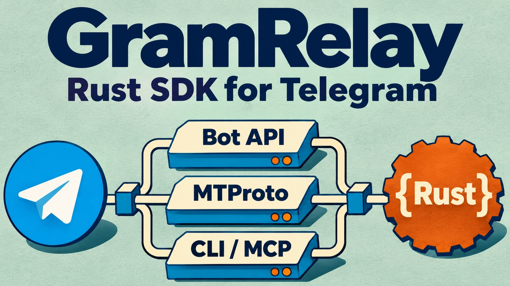

# GramRelay



GramRelay — независимый SDK для Telegram на Rust. Чтобы написать бота, начните с
типизированного клиента Bot API в крейте `tg`.

[](https://github.com/xDilettante/gramrelay/releases/tag/v0.1.0-alpha.1) · [Скачать проверенный ZIP с исходниками](https://github.com/xDilettante/gramrelay/releases/download/v0.1.0-alpha.1/gramrelay-v0.1.0-alpha.1-source.zip)

[Bot API](docs/START.md) · [MTProto](docs/MTPROTO.md) · [CLI/MCP](docs/AGENT-INDEX.md)

[Документация Telegram Bot API](https://core.telegram.org/bots/api) · [Сайт Rust](https://rust-lang.org/)

Исходники доступны для ознакомления. На собственный код GramRelay
распространяется уведомление «все права защищены». [Условия](LICENSE)

## Первый бот на Bot API

[Пошаговое руководство](docs/START.md) показывает `/start`, кнопку и ответ на
callback. Получите полный checkout и подготовьте кэш Cargo. Последняя команда
проверяет обработчики в памяти с синтетическими данными.

```powershell
git clone https://github.com/xDilettante/gramrelay.git
cd gramrelay
cargo fetch --locked
cargo run --locked --offline -p tg --example command_callback --features test-kit
```

[Рецепты Bot API](docs/RECIPES.md) помогают перейти к файлам, обработке ошибок
и работе с обновлениями.

## Подключение

```toml
[dependencies]
tg = { path = "../gramrelay" }
tokio = { version = "1", features = ["macros", "rt-multi-thread"] }
serde_json = "1" # Для примера разбора callback Update
```

Токен передаётся через доверенное окружение TELEGRAM_BOT_TOKEN. Основной вызов:

```rust,no_run
use tg::{Bot, ChatId};

#[tokio::main]
async fn main() -> tg::Result<()> {
    let bot = Bot::from_env("TELEGRAM_BOT_TOKEN")?;
    let sent = bot
        .send_message(ChatId::from(-1001234567890), "Привет!")
        .disable_notification(true)
        .await?;
    println!("message_id={}", i64::from(sent.message_id));
    Ok(())
}
```

Запрос ленивый: создание builder не обращается к сети. Действие начинается при await. Повторное бизнес-действие — отдельный вызов, который библиотека не считает дубликатом автоматически.

## Callback

```rust,no_run
use tg::{Bot, ChatId, InlineKeyboardButton, InlineKeyboardMarkup, Update};

async fn example(bot: &Bot, received_json: &str) -> Result<(), Box<dyn std::error::Error>> {
    let keyboard = InlineKeyboardMarkup::new()
        .row([InlineKeyboardButton::callback("Подтвердить", "confirm")]);
    bot.send_message(ChatId::from(123456789), "Продолжить?")
        .reply_markup(keyboard)
        .await?;

    let update: Update = serde_json::from_str(received_json)?;
    if let Some(query) = update.callback_query {
        bot.answer_callback_query(query.id)
            .text("Событие получено")
            .await?;
    }
    Ok(())
}
```

Хост проверяет право пользователя выполнять прикладное действие. Callback data не является доказательством такого права. Update можно передать вручную в Router::dispatch или получать через управляемый polling. Неизвестные поля, в том числе внутри Message, сохраняются; повреждённые известные объекты и два известных вида события в одном Update отклоняет декодер. Webhook подключается отдельно; доступны управляемые режимы с памятью и устойчивым SQLite-feed.

## Webhook-адаптер

Опция webhook включает tg::webhook::{WebhookSecret, WebhookIngress, WebhookOptions, WebhookSink}. Ingress проверяет единственный X-Telegram-Bot-Api-Secret-Token до чтения тела, резервирует квоту и разбирает полный Update. Пользовательский WebhookSink получает событие и исходный deadline; его успешный результат должен означать обработку или commit, а не запись в очередь памяти. Нельзя начинать новый deadline после ожидания тела/очереди.

WebhookIngress::router() встраивается в существующий Axum/TLS-сервер хоста. serve_until(listener, stop) запускает ограниченный HTTP/1-сервер: по умолчанию 64 соединения, 5 секунд на заголовки и 60 секунд жизни соединения. Он слушает переданный loopback listener; для доверенного TLS reverse proxy с другим адресом нужен явный trusted_proxy(true). По умолчанию путь /telegram, тело 1 MiB, 16 принятых запросов и 16 MiB резервирования, общий request_timeout 30 секунд. Остановка закрывает listener и admission, завершает принятые запросы в shutdown_timeout (30 секунд), затем отменяет и дожидается своих connection tasks. Удалённый webhook автоматически не устанавливается и не удаляется.

Этот низкоуровневый слой не проверяет getMe и не занимает источник: хост обязан проверить личность, удерживать Bot::claim_update_source(), координировать источник между процессами и выбрать дедупликацию. Bot::webhook объединяет процессное владение, Router и дедупликацию в памяти. UpdateFeed::webhook в tg-agent объединяет HTTP-адаптер с SQLite и возобновляемым source lease. Оба режима используют входящую диагностику tracing/metrics; разрешения на чтение и действия остаются частью A1.

Обычный бот с очередью и дедупликацией в памяти:

```rust,no_run
use tg::{Bot, CancellationToken, Router};
use tg::webhook::WebhookSecret;

async fn serve(
    bot: &Bot,
    listener: tokio::net::TcpListener,
    secret: WebhookSecret,
    stop: CancellationToken,
) -> tg::Result<()> {
    let router = Router::new().command("start", |ctx| async move {
        ctx.reply("Привет!").await?;
        Ok(())
    });
    bot.webhook(router, secret).serve_until(listener, stop).await
}
```

Создание builder не обращается к сети. serve_until проверяет getMe, привязывает username команд и занимает общий SDK source guard. MemoryWebhookOptions по умолчанию ограничивает ожидающие и активные события: 100 записей и 16 MiB канонического payload; DispatchOptions — 16 активных групп и 30 секунд на обработчик. Независимые чаты допускаются по мере поступления; события одного чата идут последовательно. Неизвестная область ждёт предыдущую работу и не пропускает последующие события.

Кэш хранит до 100 000 fingerprint/ID в течение 24 часов после успеха. Совпадающий успешный повтор получает 200, повтор в работе — 503, конфликтующий payload — 409. Действующие записи не вытесняются: заполнение даёт 503. Ошибка, panic или timeout не записываются как успех. Квота очереди удерживается до завершения работы даже после разрыва HTTP; просроченное событие в очереди освобождает её по исходному deadline. После stop.cancel() нужно дождаться serve_until: обработчики завершаются или отменяются с ожиданием до освобождения источника. При перезапуске память теряется; внешние эффекты требуют стабильных operation_id и подходящего хранилища.

Офлайн-пример использует настоящий localhost HTTP и синтетическую личность из test-kit:

```powershell
cargo run --locked --offline -p tg --features webhook,test-kit --example webhook_mock
```

## Polling и маршрутизация

Слой bot включён по умолчанию; клиент без него подключается через default-features = false.

```rust,no_run
use tg::{Bot, MessageContext, Router};

async fn start(ctx: MessageContext) -> tg::Result<()> {
    ctx.reply("Привет!").await?;
    Ok(())
}

#[tokio::main]
async fn main() -> tg::Result<()> {
    let bot = Bot::from_env("TELEGRAM_BOT_TOKEN")?;
    bot.run_polling(Router::new().command("start", start)).await
}
```

Router::with_state передаёт обработчикам явное общее состояние. Доступны command, on_message, callback, on_callback и on_update; выполняется первый совпавший маршрут. Ответ MessageContext::reply сохраняет chat_id, message_id, тему и business connection.

Polling проверяет getMe и getWebhookInfo, не удаляет существующий webhook и разрешает один управляемый poller на bot ID внутри процесса. Ручные вызовы get_updates и другие процессы требуют координации приложения.

По умолчанию пачка содержит до 100 событий, одновременно работают до 16 групп чатов; внутри чата порядок последовательный. При неизвестной области события вся пачка обрабатывается последовательно. Следующий offset отправляется только после успешного завершения всей пачки. Ошибка, паника или тайм-аут обработчика останавливает polling без подтверждения этой пачки. После перезапуска уже выполненные действия могут повториться: постоянный журнал ещё не интегрирован.

run_polling обрабатывает Ctrl-C и завершает принятую работу в пределах shutdown timeout. Для встраивания в приложение используйте run_polling_until с PollingOptions и CancellationToken: этот вариант не регистрирует обработчик сигналов. Серверный poll_timeout должен быть меньше общего deadline клиента. Первые значения по умолчанию — 20 секунд для long polling и 30 секунд для обработчика/остановки. Транспортные ошибки возвращаются вызывающему коду; автоматического перезапуска пока нет.

## Файлы

```rust,no_run
use tg::{Bot, ChatId, InputFile};

async fn example(bot: &Bot, chat: ChatId) -> tg::Result<()> {
    let sent = bot
        .send_document(chat, InputFile::path("report.pdf"))
        .caption("Отчёт")
        .await?;

    if let Some(document) = sent.document {
        bot.send_document(chat, InputFile::file_id(document.file_id.as_str()))
            .await?;
    }
    Ok(())
}
```

InputFile::bytes поддерживает уже имеющийся буфер. InputFile::path открывает обычный файл при выполнении запроса и передаёт его потоком, без чтения всего файла в RAM. Поток ограничен размером, полученным из открытого файла; файл следует сохранять неизменным до завершения отправки. Локальные пути предназначены для доверенного кода приложения, а не для непосредственного ввода модели.

## Ошибки и тайм-ауты

По умолчанию builder делает одну попытку; внутренние повторы reqwest отключены. У сгенерированных запросов есть явная RetryPolicy для проверенных безопасных случаев.

| Состояние ошибки | Значение |
|---|---|
| NotSent | Запрос не передан HTTP-клиенту: локальная валидация, ошибка подготовки файла, перегрузка или deadline до …5415 tokens truncated…0438 фактически прочитанные chunks. Endpoint строится под доверенным api_url; некорректные пути не становятся URL или локальными файлами. to_writer не создаёт/не закрывает/не flush-ит назначение; при ошибке или отмене в нём может остаться префикс. Для bytes частичный успешный результат не возвращается. Автоматических повторов нет.

Проверенные чтения можно повторять явно:

```rust
let me = bot.api().get_me()
    .retry_policy(tg::RetryPolicy::default().max_attempts(3))
    .await?;
```

Политика ограничивает общее время (по умолчанию 30 секунд), попытки (3) и exponential backoff (100 ms…5 s) с jitter. retry_after не сокращается. Локальные ошибки, миграции, постоянные ошибки, credential/session-операции и Unknown-записи не повторяются. retry_rejected_writes(true) отдельно разрешает повтор обычной JSON-записи только после подтверждённого Bot API 429; короткоживущие query/ephemeral-ссылки исключены. Для upload-потоков такая политика возвращает retry_attachments до открытия файлов. Backoff не удерживает in-flight permit; отмена не оставляет фоновых попыток. Для воспроизводимых проверок есть jitter(false).

Инструмент разработки tools/schema.py использует стандартную библиотеку Python 3 и не обращается к сети. Сгенерированные файлы хранятся в Git; обычной сборке Cargo Python не нужен. Проверка и регенерация:

```powershell
python -m unittest discover -s tools/tests -v
python tools/schema.py generate
python tools/schema.py check
```

Для обновления схемы разработчик отдельно сохраняет официальную страницу в target/schema-cache/api.html и запускает python tools/schema.py import --source target/schema-cache/api.html. Изменение версии или количества определений требует явного пересмотра schema/expected.json. Файл schema/overrides.json содержит проверенные исключения; ненужные исключения и неизвестные типы вызывают ошибку.

## Постоянный журнал операций

Пакет tg-agent добавляет SQLite-журнал отдельно от зависимостей обычного клиента. Он атомарно резервирует ключи, связывает владельца и параметры, сохраняет результаты и после сбоя переводит незавершённую попытку в unknown. Для истёкшего или удалённого тела результата ключ не становится новым. Состояния и версии проверяются между отдельными процессами; действие начинается только после commit in_flight.

```powershell
cargo run --locked --offline -p tg-agent --example journal
```

Пример использует тестовый транспорт и проверяет две попытки обращения к журналу с одной отправкой. [Контракт и настройки tg-agent](tg-agent/README.md), [спецификация J1](SPEC-journal.md). Опция executor объединяет восемь действий с текущими grant/approval, долговечными квотами, областью bot/chat/file и безопасными квитанциями. Общий JSON-слой, CLI с run/serve и MCP stdio по конфигурации хоста реализованы; [руководство MCP](docs/AGENT-MCP.md) описывает запуск, лимиты и восстановление; доступ к хранилищу сам по себе не выдаёт разрешения Telegram. Офлайн-примеры authorized_send, authorized_read, authorized_callback и authorized_document показывают общий исполнитель без реальной сети.

## Устойчивый приём и подписчики

UpdateFeed в tg-agent сохраняет события, локальные курсоры, дедупликацию и независимые позиции подписчиков в SQLite. Приём polling подтверждает Telegram только после commit всего пакета. Подписчик отдельно подтверждает успешную обработку; после сбоя неподтверждённая пачка читается снова. Аренды ограничивают владельцев между процессами, а продление во время обработки прекращается при остановке или потере владения. Для внешних эффектов обработчика нужны стабильные operation_id: общей транзакции с Telegram нет.

Опция bot у tg-agent включает run_polling_until и run_consumer_until. Хранилище само по себе её не включает. Управляемые источники разделяют SDK guard по ID бота; прямые вызовы API требуют координации хоста. Общий Bot::dispatch_batch также доступен для своих источников с ограничениями DispatchOptions. [Контракт J2](SPEC-update-journal.md) описывает хранение, тайм-ауты и восстановление.

```powershell
cargo run --locked --offline -p tg-agent --features bot --example durable_bot
```

## Тесты без сети

Опция test-kit предоставляет tg::test_kit::{MockTransport, Step, MockResponse}. Пример запускается с синтетическим токеном в памяти:

```powershell
cargo run --locked --offline --features test-kit --example test_kit
```

MockTransport::new([...]) задаёт последовательность ожидаемых методов. Step::reply принимает ответ с envelope Bot API; Step::timeout, transport_error и partial_upload моделируют неопределённый исход. MockResponse поддерживает HTTP-статус, задержку заголовков/chunks, повреждённые ответы и прерывание потока. bot() создаёт обычный Bot, bot_builder() позволяет настроить его реальные тайм-ауты и лимиты. Непредусмотренный метод или исчерпанный сценарий возвращает ошибку; сетевого fallback нет.

requests() возвращает снимок фактически сериализованных запросов. decode::<api::methods::SendMessage>() проверяет имя метода и декодирует строгие JSON-параметры; body() позволяет проверить настоящий multipart и частично прочитанный upload. Debug скрывает данные fixtures и записей. Используйте синтетические данные: явное чтение body/decode намеренно раскрывает содержимое теста.

По умолчанию сценарий и история ограничены 256 запросами, общие записанные тела — 1 MiB; отдельный такой же лимит действует на тела ответов сценария. with_limits меняет эти доверенные настройки. assert_finished() проверяет, что шаги использованы, а потоки завершены или отменены. В обработчике можно использовать тот же Router::dispatch с подготовленными Update. При ошибках и отмене действуют общие правила Unknown и освобождается semaphore.

## Диагностика

Опции tracing и metrics подключаются отдельно и выключены по умолчанию. Приложение устанавливает собственный subscriber/recorder; библиотека не меняет глобальную конфигурацию. Target tg создаёт span tg.request с локальным attempt_id и событие request_finished с method, result, outcome, error_kind и duration_seconds. Span связан с текущим span приложения. Токены, URL, ID чатов, тексты и файлы не включаются.

Webhook POST-pipeline создаёт span tg.webhook с attempt_id и событие webhook_finished с фиксированными result/status/reason и duration_seconds. Метрики tg.webhook.requests и tg.webhook.duration_seconds используют только эти ограниченные категории; tg.webhook.active считает текущие pipeline до решения/отмены. accepted означает решение после обработки/commit, а не доказательство доставки ответа по сети. Отмена pipeline учитывается отдельно и освобождает gauge. В поля и метки не включаются URL/route, peer, bot/chat/update IDs, секреты и содержимое. Глобальный panic hook и диагностика внешнего TLS-сервера остаются настройкой хоста.

Метрики tg.request.attempts, tg.request.duration_seconds и tg.request.active позволяют считать ошибки/отмены, строить перцентили и наблюдать активные попытки. Метки ограничены именами методов и фиксированными категориями; attempt_id не используется как метка. Каждая повторная попытка учитывается отдельно. Отмена после отправки имеет outcome=unknown; перегрузка — not_sent. Локальная валидация до общего пути исполнения не создаёт попытку. Exporter и histogram buckets выбирает приложение.

## Примеры и проверка Bot API

Из корня проекта с загруженными зависимостями можно запустить локальный HTTP mock
и тесты крейта `tg`.

```powershell
cargo run --locked --offline -p tg --example mock_send
cargo test --locked --offline -p tg --all-targets --all-features
cargo test --locked --offline -p tg --doc
```

Примеры ниже обращаются к Telegram при запуске с подготовленным окружением.

```powershell
cargo run -p tg --example send_message -- 123456789 "Привет!"
cargo run -p tg --example upload_document -- 123456789 "C:/path/report.pdf"
cargo run -p tg --example answer_callback -- "C:/path/update.json"
cargo run -p tg --example polling
```

Тесты Bot API охватывают JSON и multipart, callback, файлы, тайм-ауты, лимиты,
секреты в диагностике, маршрутизацию, polling и webhook.
[Матрица совместимости](docs/COMPATIBILITY.md) · [Результаты проверок](tasks/todo.md)

## Другие крейты GramRelay

- [MTProto в крейте tg-mtproto](docs/MTPROTO.md) предоставляет собственные сессии,
  авторизацию и работу с Telegram API. В руководстве есть офлайн-примеры и
  команды проверки.
- [CLI/MCP в крейте tg-agent](docs/AGENT-INDEX.md) добавляет разрешения, журнал и
  инструменты для агентов. Поддержка MTProto включается опцией `mtproto`.

Текущая версия пакетов — `0.1.0-alpha.1`. Минимальная версия Rust — 1.89.
[Подключение из исходников](docs/INSTALL-SOURCE.md) · [Архитектура](docs/ARCHITECTURE.md) ·
[Упаковка для частного реестра](docs/PRIVATE-DISTRIBUTION.md) · [Лицензия](LICENSE)
