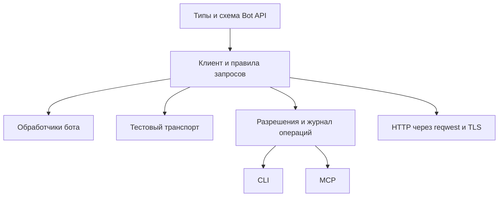

# Архитектура библиотеки Telegram для Rust

Source: https://chatgpt.com/space/page_6dad39b3793c8191b60060a1686ecc79

+Проект архитектуры от 16 ноября 2026 года. Библиотека предназначена для разработчиков и ИИ-агентов: писать ботов на Rust, проверять их без сети и выполнять разрешённые действия в Telegram через инструменты. Охват согласован: сначала Bot API, затем отдельное расширение для MTProto. Удобство генерации кода и удобство выполнения действий агентом входят в первую продуктовую версию.

# Продукт и границы

Главная ценность — предсказуемая работа с Telegram: короткий обычный код, явный результат при сбоях, воспроизводимые тесты и единое поведение Rust API, CLI и MCP. Конкурентоспособность оценивается по этим сценариям и измерениям, а не по числу обёрнутых методов.

Первая версия включает типизированный клиент Bot API, небольшой слой обработки событий, polling и webhooks, потоковую работу с файлами, тестовый транспорт, документацию для агентов и отдельный адаптер CLI/MCP. В адаптере сначала доступны основные операции; остальная поверхность Bot API остаётся доступной из Rust и постепенно получает проверенные инструменты.

Первые платформы — Linux, Windows и macOS, асинхронная работа на Tokio и стабильный Rust с edition 2024. Минимальную версию компилятора фиксируем после проверки зависимостей. Собственные криптографические примитивы, свой HTTP/TLS, универсальная поддержка всех async runtime, no_std, браузерный WASM и встроенный LLM-провайдер не входят в первую версию.

# Положение среди существующих библиотек

На 16 ноября 2026 года официальная страница Telegram описывает Bot API 10.4, выпущенный 9 ноября. Это исходная версия для первого снимка схемы. [Telegram Bot API](https://core.telegram.org/bots/api).

| Проект | Что уже предлагает | Что следует учитывать при проектировании |
|---|---|---|
| teloxide | Фреймворк ботов, маршрутизация через dptree, состояния и расширения | Документация 0.17.0 указывает поддержку Bot API 9.1; полезен как ориентир функциональности и сценариев миграции |
| frankenstein | Типизированное соответствие типам и параметрам Bot API | Документация 0.52.1 указывает Bot API 10.3; ориентир для сравнения самого клиента |
| grammers | Высокоуровневый клиент Telegram API для пользовательских и бот-аккаунтов | Кандидат на основу будущего MTProto-модуля; сравнивать его следует отдельно от HTTP Bot API |

Источники: [teloxide](https://docs.rs/teloxide/latest/teloxide/), [frankenstein](https://docs.rs/frankenstein/latest/frankenstein/), [grammers](https://docs.rs/grammers-client/latest/grammers_client/).

Проверяемая продуктовая гипотеза: выиграть можно согласованностью API, документации, тестирования и инструментов агента, особенно в обработке сбоев. Это не утверждение, что у конкурентов отсутствуют отдельные такие возможности.

# Модули и направление зависимостей

Названия tg и tg-agent ниже служат обозначениями в проекте архитектуры. Доступность имён в реестрах ещё предстоит проверить.

| ID модуля | Ответственность | Зависит от |
|---|---|---|
| protocol | Типы, запросы, ответы и проверенная схема Bot API | — |
| client | HTTP, файлы, ограничения нагрузки, ошибки и правила повторов | protocol |
| bot-runtime | Маршруты, контексты, polling, webhooks и остановка | client |
| test-kit | Поддельный транспорт, записи запросов и моделирование сбоев | client |
| agent-runtime | Разрешения, журнал операций, CLI и MCP | client |
| mtproto | В будущем: клиентские сессии и возможности Telegram API | Отдельный backend; зависимости уточняются при его выборе |

Первоначально публикуются два пакета: tg с модулями protocol/client и подключаемыми bot-runtime/test-kit; tg-agent с CLI/MCP и журналом. Такой состав отделяет зависимости инструментов и базы данных от обычного клиента. Генератор схемы остаётся внутренним инструментом разработки. Дополнительные пакеты выделяются при появлении реальной потребности.

Порядок разработки: protocol → client → test-kit → bot-runtime и agent-runtime → MTProto после проверки Bot API версии.



# Публичный Rust API

Обязательные параметры передаются при создании запроса, необязательные — понятными методами builder. Названия соответствуют Bot API в snake_case. Для обычных вызовов не нужно импортировать дополнительные request-traits. Один способ завершения запроса: await; запрос ленивый, до выполнения сетевых действий нет. Builder реализует IntoFuture и помечен must_use.

Два уровня используют одни и те же запросы: прямой клиент для интеграций и контекст обработчика для ботов. Ниже показан проект интерфейса; это контракт для будущей реализации.

```rust
use tg::{Bot, ChatId};

#[tokio::main]
async fn main() -> tg::Result<()> {
    let bot = Bot::from_env("TELEGRAM_BOT_TOKEN")?;
    let chat = ChatId::from(123456789_i64);

    let sent = bot
        .send_message(chat, "Привет!")
        .disable_notification(true)
        .await?;

    println!("message_id={}", sent.id);
    Ok(())
}
```

```rust
use tg::{Bot, MessageContext, Router};

async fn start(ctx: MessageContext) -> tg::Result<()> {
    ctx.reply("Привет! Команды: /help и /status").await?;
    Ok(())
}

#[tokio::main]
async fn main() -> tg::Result<()> {
    let bot = Bot::from_env("TELEGRAM_BOT_TOKEN")?;
    let router = Router::new().command("start", start);
    bot.run_polling(router).await
}
```

ChatId, UserId, MessageId, InlineMessageId и FileId — разные типы. Ссылка на обычное сообщение содержит chat_id и message_id; inline-сообщение имеет отдельный вариант адресации. Автоматического преобразования UserId в ChatId нет. В инструментах агента идентификаторы передаются строками и проверяются при преобразовании в типы Rust.

Обработчики — обычные async-функции. Состояние передаётся через явный Context<State> с общим Arc<State>; зависимости не извлекаются из скрытого глобального контейнера. Сложные диалоги используют enum состояния и явно выбранное хранилище.

По умолчанию текст отправляется без разметки. Тип RichText собирает entities и рассчитывает смещения; HTML и Markdown включаются явно. Telegram использует UTF-16 code units для смещений entities, поэтому emoji и составной Unicode входят в обязательные тесты. [MessageEntity](https://core.telegram.org/bots/api#messageentity).

# Ошибки и повторные запросы

Библиотека возвращает единый Error с устойчивым библиотечным code, категорией, безопасным описанием, параметрами Telegram и состоянием эффекта. Категории: Validation, Transport, Telegram, Decode, Policy, Capacity и Cancelled. Текст Telegram не используется как надёжный машинный классификатор.

Состояние эффекта отделено от причины ошибки: not_sent — есть доказательство, что попытка не отправлена; rejected — получен однозначный отказ; succeeded — получен успешный результат; unknown — действие могло выполниться, но подтверждения нет. Успешный HTTP-статус с повреждённым ответом также может оставить эффект unknown.

| Ситуация | Поведение по умолчанию |
|---|---|
| Ошибка локальных параметров или запрет политики | Завершить до сети, not_sent |
| Однозначный отказ с retry_after | Подождать в пределах общего deadline; повторить только воспроизводимое тело запроса |
| Сбой безопасной для повтора операции | Ограниченные попытки с backoff и jitter |
| Тайм-аут, разрыв связи или неоднозначный 5xx при отправке | unknown; автоматически не повторять |
| Изменение адресата при миграции чата | Вернуть новый chat_id; адаптер повторно проверяет разрешения |
| Отмена во время сетевого запроса | Не обещать отмену эффекта на стороне Telegram |

Telegram возвращает retry_after при flood control. Остальная классификация безопасности повторов — собственный контракт библиотеки. [ResponseParameters](https://core.telegram.org/bots/api#responseparameters).

Методы классифицируются по семантике, а не по приставке get: например, получение updates с offset подтверждает ранее полученные события. Для каждого запроса учитываются также воспроизводимость upload-потока и оставшийся deadline. Повторы внутри HTTP-клиента должны подчиняться той же политике.

# Приём событий и конкурентное выполнение

Обработка разных чатов выполняется параллельно, внутри одного chat key — последовательно в порядке допуска событий в обработку. Это не обещает восстановить исходный порядок webhook-событий, уже пришедших переставленными. Для состояния, общего между темами, ключом по умолчанию служит пара bot_id и chat_id; другую область сериализации приложение выбирает явно.

Ограничиваются число активных обработчиков, длина очереди, суммарные байты очереди и размер отдельного события. Превышение возвращает явную перегрузку либо приостанавливает приём; события не отбрасываются молча. Число отслеживаемых chat keys тоже ограничивается, неактивные ключи очищаются. Конкретные значения по умолчанию выбираются по нагрузочному испытанию.

Polling имеет одного владельца на бот-токен. Offset продвигается только за завершённый префикс полученной последовательности или после надёжной записи этого префикса в журнал. Нельзя подтверждать максимум update_id, пока более ранний обработчик ещё не закончен. Важно учитывать пропуски идентификаторов; это не ожидание каждого целого числа.

Webhook отвечает 2xx после успешной обработки или надёжного сохранения события. Простая запись в очередь в памяти не даёт гарантии пережить остановку процесса. Повторные update_id отсеиваются в пределах выбранного хранилища; режим памяти и режим с журналом имеют разные гарантии восстановления.

Polling и webhooks взаимно исключаются; Telegram хранит неполученные updates не более 24 часов. Установка webhook требует проверки secret_token на входе. [Получение событий](https://core.telegram.org/bots/api#getting-updates), [setWebhook](https://core.telegram.org/bots/api#setwebhook).

Штатная остановка прекращает приём, ограниченное время ожидает активные задачи и фиксирует прогресс. Паника обработчика становится наблюдаемым сбоем задачи. Отмена и повтор обработчика не обеспечивают однократность его внешних действий.

# Инструменты для выполнения действий агентом

Пакет tg-agent предоставляет CLI с JSON-вводом/выводом и MCP через stdio. Оба адаптера используют общие типы, проверки и исполнитель. Для MCP применяется официальный Rust SDK rmcp; собственная реализация протокола не нужна. [Rust SDK MCP](https://github.com/modelcontextprotocol/rust-sdk).

Начальный набор: get_me, get_chat, read_updates, send_message, edit_message_text, answer_callback_query, get_operation и send_document по зарегистрированному файловому handle. Удаление, административные действия, платежи и массовые операции добавляются отдельными разрешениями. Нет инструмента raw_call, который обходил бы правила.

read_updates читает локальный журнал событий с cursor и limit. Он не запускает конкурирующий getUpdates и не обещает произвольную историю чатов, недоступную этому Bot API-клиенту. Период хранения и доступ к содержимому задаются оператором.

Каждый инструмент имеет входную и выходную JSON Schema, примеры успешного результата и ошибки, описание эффекта и правила повторов. Список и порядок инструментов стабильны. Аннотации MCP описывают поведение, но контроль доступа выполняется сервером независимо от подсказок модели. [MCP tools](https://modelcontextprotocol.io/specification/2026-07-28/server/tools).

Разрешения задаёт приложение или оператор: профиль бота, доступные операции, чаты, файлы, лимиты количества и стоимости. Постоянный grant позволяет работать без подтверждения каждого обычного вызова; отдельные подтверждения задаются политикой хоста там, где они нужны. Модель не может выдавать себе новые права через аргументы инструмента. Проверка текущих прав и владельца операции выполняется также перед выдачей сохранённого результата и в get_operation: знание operation_id само по себе не даёт доступа к данным.

Токен хранится в процессе или доверенном хранилище и не передаётся в аргументах tools. Произвольные пути к файлам и адрес API-сервера также не принимаются от модели. Upload использует handle, заранее выданный хостом, и ограничение размера. Проверка dry-run проверяет только локальный запрос и политику: она не подтверждает будущий успех в Telegram.

Тексты Telegram остаются недоверенными данными. Они не могут менять разрешения, инструкции сервера и конфигурацию. Библиотека предоставляет эту границу и метаданные; устойчивость самого агента к prompt injection также зависит от его хоста.

# Журнал операций агента

Каждое изменяющее действие имеет operation_id, который инициатор создаёт один раз и сохраняет при повторах. Журнал сначала атомарно резервирует ключ, затем записывает состояние попытки до обращения в сеть. Повтор с тем же ключом и другим payload отклоняется; одновременно выполняющиеся дубликаты не отправляются повторно.

Для MVP подходит SQLite с уникальным ограничением на профиль бота и operation_id. Состояния записи: prepared, in_flight, succeeded, rejected и unknown. Переход в in_flight выполняется атомарно по владельцу и версии записи. Только победивший исполнитель начинает сетевую попытку; потерявший владение не отправляет запрос. Незавершённая попытка остановившегося исполнителя становится unknown, а активные попытки других исполнителей не изменяются. После начала сетевой попытки истечение lease не разрешает другому исполнителю повторную отправку. Результат succeeded возвращается из журнала; unknown требует проверки или решения инициатора.

Срок хранения ключей должен перекрывать все поддержанные пути повторной доставки. Очистка ключа завершает гарантию локального подавления дублей для этого ключа; просроченные операции не должны незаметно становиться новыми. Данные журнала содержат минимум необходимого, права доступа ограничены; хранение текста и вложений настраивается.

Этот механизм подавляет повторные попытки внутри исполнительной системы. Он не создаёт транзакцию между локальной БД и Telegram: остановка между выполнением действия и сохранением ответа сохраняет неопределённость.

```json
{
  "operation_id": "report-2026-11-16-001",
  "status": "unknown",
  "error": {
    "code": "OUTCOME_UNKNOWN",
    "message": "Подтверждение отправки не получено",
    "automatic_retry_allowed": false
  },
  "next_action": "get_operation"
}
```

get_operation возвращает сохранённые сведения о попытке. Сам по себе этот вызов не может восстановить неизвестный результат Telegram; он может показать поздно полученное подтверждение или данные для решения оператора.

# Удобство разработки для человека и агента

Документация версионируется вместе с кодом: короткий quickstart, рецепты по задачам, справочник типов, таблица ошибок, правила повторов и миграции. Основной язык справочника и API — английский для охвата экосистемы; русское руководство содержит обзор и ключевые рецепты. Примеры компилируются в CI.

Компактный индекс llms.txt и отдельные страницы по задачам позволяют загрузить только нужный контекст. Каждая страница указывает версию crate и Bot API. Машинный каталог методов содержит параметры, ограничения, эффект и возможность повтора; описания риска проходят отдельную проверку человеком.

test-kit записывает вызовы, выдаёт подготовленные ответы и моделирует 429, тайм-аут после отправки, перестановку событий, отмену и частично прочитанный upload. У агента есть один документированный способ проверить обработчик без настоящего токена. Примеры тестов используют тот же сериализатор и обработчик ответа, что production-клиент.

Минимальные импорты, обычные async-функции и единый builder важнее большого набора макросов. Собственные DSL и процедурные макросы в первой версии не требуются.

# Производительность и защита данных

Основные зависимости: Tokio, reqwest с rustls, serde/serde_json; подключаемые tracing и интеграция webhooks. В tg-agent добавляются официальный MCP SDK и SQLite-адаптер. Точные версии и MSRV фиксируются после технического прототипа, затем проверяются на минимальной и текущей stable версии Rust.

Один HTTP client с пулом соединений переиспользуется всеми клонами Bot. Это соответствует рекомендации reqwest для повторных запросов. Файлы передаются потоком с контролем размера; повтор upload возможен только из источника, который можно открыть заново. Для одноразового потока не создаётся скрытая копия всего файла в RAM. [reqwest](https://docs.rs/reqwest/latest/reqwest/).

Нет глобальной блокировки на сетевом пути и безграничного spawn на каждый update. CPU-затратные операции ограничиваются отдельно. Параллелизм, очередь и ограничения Telegram учитываются независимо: более высокая конкурентность не увеличивает серверную квоту. Ограничения скорости адаптируются к ответам сервера; опубликованные Telegram лимиты служат исходными настройками. [Bots FAQ](https://core.telegram.org/bots/faq#how-do-i-avoid-hitting-limits).

В собственных crates запрещён unsafe. Токены не реализуют открытые Display/Debug/Serialize. Санитизация применяется также к вложенным ошибкам HTTP: путь URL Bot API содержит токен. По умолчанию запрещены redirects; proxy и собственный API endpoint задаются явно. TLS проверяет сертификаты, исключение для локального сервера включается отдельной конфигурацией.

В журналах по умолчанию — метод, длительность, размер, request_id, категория ошибки и состояние эффекта. Тексты сообщений, файлы и токены туда не попадают. Метрики используют ограниченный набор labels без chat_id и user_id. Защита данных пользователя и проверка зависимостей входят в выпускной процесс.

# Схема API и совместимость

Версионируемая внутренняя схема служит источником типов, запросов, builders, справочника и JSON Schema. Изменения официальной документации импортируются в отдельное обновление схемы с проверкой union-типов, обязательности полей, числовых диапазонов и правил повторов. Семантику риска нельзя надёжно получать только из сигнатуры метода.

Снимок входных данных и сгенерированные файлы хранятся в репозитории. Сборка пользователя не скачивает схему и не запускает генерацию из сети. Генератор должен воспроизводить тот же результат из закреплённого снимка.

Новые необязательные поля не ломают чтение известных объектов. Для неизвестных видов событий и расширяемых строковых вариантов предусмотрено сохранение исходного значения. Повреждённый известный объект выдаёт Decode error и не маскируется под неизвестное событие.

Выходные enum и структуры допускают добавление вариантов и полей через non_exhaustive; входные запросы создаются конструкторами и builders. Версия Bot API и версия crate различаются. К 1.0 фиксируются стабильная поверхность, политика MSRV и правила SemVer; изменения семантики повторов и разрешений тоже считаются изменениями контракта.

# Расширение до MTProto

Bot API и Telegram API имеют разные модели возможностей и авторизации. Поэтому будущий tg-mtproto предоставляет отдельный Client и собственные типы сессий; он не притворяется Bot с другим transport. [Telegram APIs](https://core.telegram.org/api).

Перед выбором backend выполняется прототип двух вариантов: grammers как Rust-клиент и TDLib через FFI. grammers уменьшает сложность поставки C++-библиотеки; TDLib берёт на себя сеть, шифрование и локальное хранение, но добавляет нативную сборку. Сравниваются функциональное покрытие, восстановление updates, управление сессиями, переносимость и стоимость сопровождения. [grammers](https://docs.rs/grammers-client/latest/grammers_client/), [TDLib](https://core.telegram.org/tdlib).

Приватные сессии, вход с 2FA, восстановление соединения, flood waits и пагинация истории получают отдельные контракты и тесты. Профиль бота и профиль пользовательского аккаунта различаются в политике агента. Общими могут стать журнал, формат ошибок и правила разрешений; общий trait для всех методов Telegram заранее не вводится.

# Проверка качества и критерии приёмки

Ниже — целевые критерии разработки, а не уже полученные результаты.

| Качество | Проверка и целевой результат |
|---|---|
| Полнота | Все методы и типы закреплённой версии Bot API отражены в проверенной схеме и клиенте |
| Простота для человека | Новый пользователь запускает бота с командой и callback по руководству за 15 минут при готовом токене |
| Простота для агента | Не менее 80% из 30 закреплённых задач решаются с первой проверкой сборки и тестов; фиксируются модель, версия документации и бюджет контекста |
| Поведение при сбоях | Тесты не допускают автоматического повтора unknown-действия, преждевременного offset и обхода политики |
| Производительность | На одинаковых сценариях локального HTTP mock p95 полного пути не хуже teloxide/frankenstein более чем на 20%; затем отдельно оцениваются CPU, аллокации и сеть |
| Нагрузка | При достижении настроенных лимитов число задач и память очередей остаются ограниченными; перегрузка наблюдаема |
| Безопасность | Проверяются утечки токенов во всех цепочках ошибок, запреты чатов/методов, смена адресата и файловые handles |
| Переносимость | Сборка и тесты проходят на Linux, Windows и macOS, на MSRV и текущем stable |

Порог производительности пересматривается по первому воспроизводимому baseline; без одинаковых fixtures и конфигурации сравнительные цифры не публикуются. Скорость HTTP Bot API и MTProto сравнивается только в отдельных категориях.

Тестовый набор включает golden JSON-контракты, компиляцию примеров и проверки несовместимых ID, Unicode/entities, неизвестные варианты ответа, нормальные и повреждённые ответы, rate limits, повторы, одноразовые потоки и конкурентную обработку.

Отдельно моделируются падение между отправкой и сохранением результата, дубликаты webhook, остановка до подтверждения offset и несколько исполнителей с одним operation_id. Fuzzing применяется к декодированию внешних данных и обработке разметки. Сетевые smoke-тесты выполняются только в специально настроенном тестовом чате; основная проверка не требует настоящего токена.

Ожидаемые команды после появления workspace: cargo fmt --all -- --check; cargo clippy --workspace --all-targets -- -D warnings; cargo test --workspace; cargo test --workspace --doc; отдельные проверки поддержанных feature-комбинаций и воспроизводимости генератора. Команды здесь задают будущие требования к репозиторию.

# Этапы выпуска и ключевые решения

1. Проверить интерфейс на небольшом прототипе: send_message, callback, upload, mock-тест и unknown после тайм-аута. Зафиксировать baseline размера зависимостей, сборки и скорости.

2. Выпустить alpha клиента: полная проверенная схема, ошибки, обработка файлов и test-kit. Одновременно проверить несколько реальных задач человека и агента.

3. Подготовить первую продуктовую beta: polling, webhooks, маршруты, ограничение нагрузки, журнал и основные инструменты CLI/MCP. Оба сценария ИИ присутствуют в этой beta.

4. Довести Bot API до 1.0 по критериям приёмки: совместимость, документация, миграции, эксплуатация и публичные воспроизводимые измерения.

5. Начать MTProto с отдельного прототипа backend и проверки работы с пользовательской сессией.

| Решение | Причина |
|---|---|
| Собственный небольшой клиент поверх reqwest | Нужен контролируемый контракт ошибок, повторов, codegen и инструментов; HTTP и TLS остаются стандартными |
| Один основной crate и отдельный пакет инструментов | Быстрый старт без зависимостей MCP/SQLite у обычного бота |
| Tokio как первый runtime | Сокращает поверхность поддержки и хорошо сочетается с выбранным HTTP-клиентом |
| Явный unknown | Сохраняет правдивый результат при потере подтверждения |
| Постоянные grants в политике хоста | Позволяют автономную работу в заранее разрешённых границах |
| Отдельный MTProto Client | Сохраняет различия возможностей, сессий и гарантий двух API |

Главные продуктовые риски — обслуживание меняющегося API, неудобные типы и непрозрачные сбои. Поэтому до расширения числа возможностей проверяются реальные примеры, надёжность повторов и успешность работы агентов.
